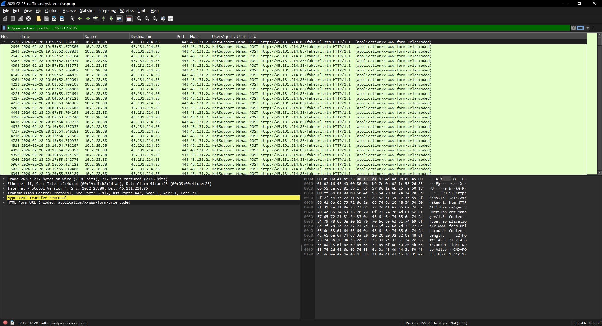
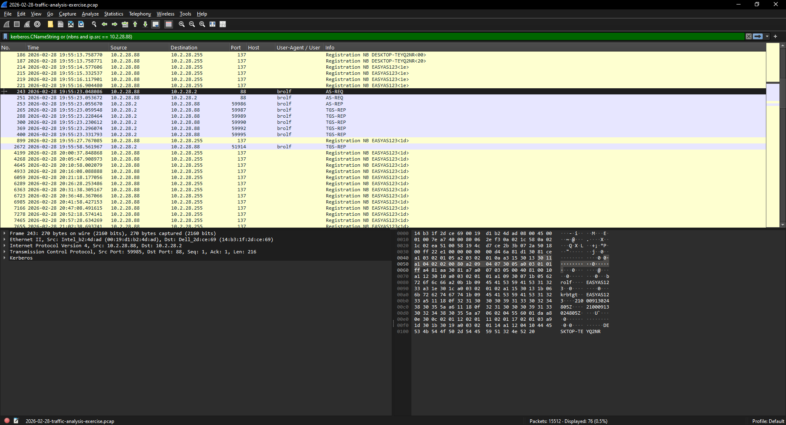

# 01: NetSupport RAT

Exercise: [2026-02-28 "Easy as 123"](https://www.malware-traffic-analysis.net/2026/02/28/index.html)

Scenario: the SIEM shows NetSupport Manager RAT alerts for traffic to 45.131.214[.]85 on port 443, starting 2026-02-28 around 19:55 UTC. I had the pcap and needed to find which machine and user it was.

## Summary

The infected machine is DESKTOP-TEYQ2NR (10.2.28.88), used by Becka Rolf (brolf). It was checking in to the NetSupport C2 at 45.131.214[.]85 about once a minute from 19:55 until the pcap ends a little after midnight, so the attacker had remote access the whole time.

## Victim

| | |
|---|---|
| IP | 10.2.28.88 |
| MAC | 00:19:d1:b2:4d:ad |
| Hostname | DESKTOP-TEYQ2NR |
| User | brolf |
| Full name | Becka Rolf |

## Timeline (UTC)

| Time | What happened |
|---|---|
| 19:55:07 | DHCP, host shows up as DESKTOP-TEYQ2NR |
| 19:55:23 | brolf logs in (Kerberos) |
| 19:55:51 | DNS lookup for vadusa[.]xyz, resolves to 45.131.214[.]85 |
| 19:55:51 | First check-in, POST to /fakeurl.htm |
| until 00:16 | 264 check-ins total, about 1 per minute |

## How I found it

- Filtered `ip.addr == 45.131.214.85`. Only one internal IP talks to it: 10.2.28.88.
- The traffic is on port 443 but it's not TLS. It's plain HTTP POSTs to `/fakeurl.htm` with the User-Agent `NetSupport Manager/1.3`, so that confirms the alert.
- `nbns` and `dhcp` gave me the hostname and MAC.
- `kerberos.CNameString` gave me the username brolf.
- For the full name I searched packet details for "Rolf" and found it in a SAMR QueryUserInfo response.
- Right before the first check-in there's a DNS query for vadusa[.]xyz that resolves to the C2 IP.

I couldn't see how it got infected in the first place. The pcap starts when the machine boots up and the RAT is already installed.

## IOCs

```
45.131.214[.]85:443                   NetSupport C2
vadusa[.]xyz                          resolves to C2
hxxp://45.131.214[.]85/fakeurl.htm    check-in URL
User-Agent: NetSupport Manager/1.3
```

## MITRE ATT&CK

- T1219 Remote Access Software (NetSupport)
- T1071.001 Web Protocols (C2 over HTTP)
- T1571 Non-Standard Port (HTTP on 443)

## What I'd do

1. Isolate the machine.
2. Block the IP and domain.
3. Reset brolf's password.
4. Search firewall/proxy logs for any other host hitting that IP or using that user agent.
5. Reimage.

Something worth alerting on in general: HTTP traffic on port 443 with no TLS handshake.

## Screenshots



