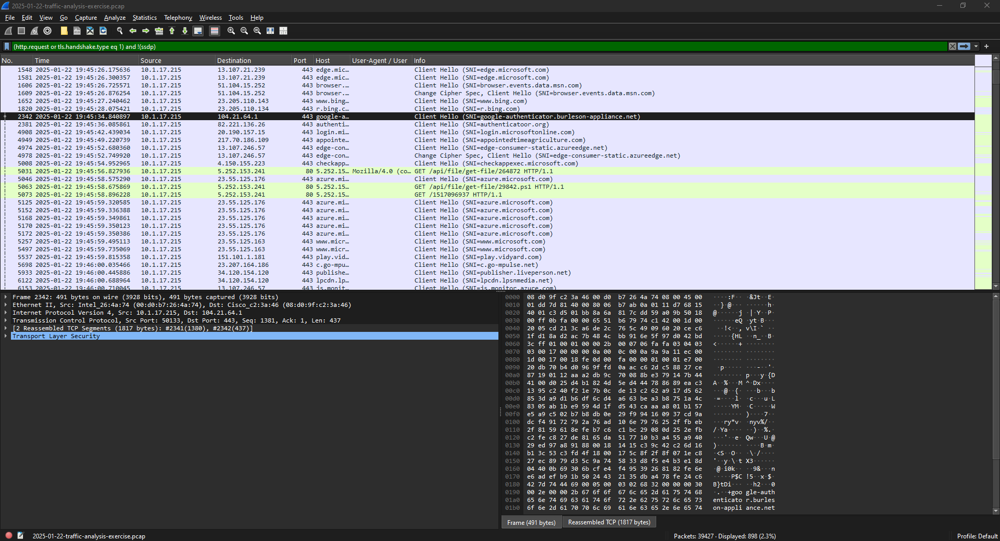
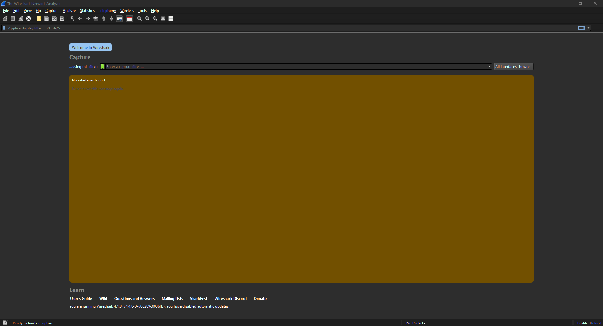
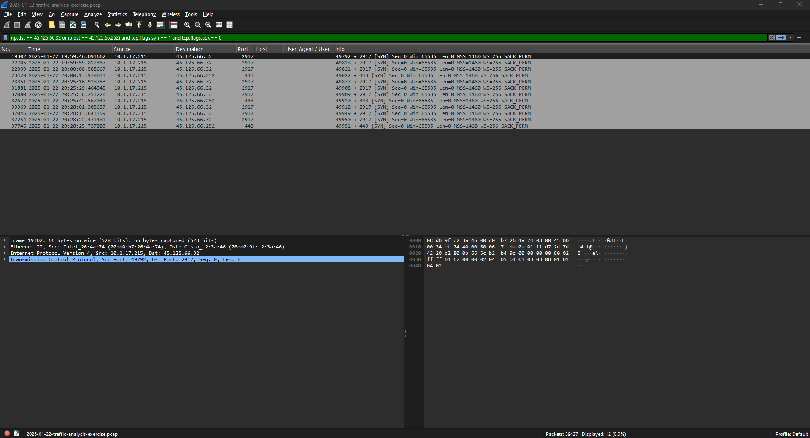

# 02: Fake Google Authenticator download

Exercise: [2025-01-22 "Download from fake software site"](https://www.malware-traffic-analysis.net/2025/01/22/index.html)

Scenario: a coworker reported that someone downloaded a suspicious file after searching for Google Authenticator.

## Summary

Steve Hutchenson (shutchenson) on DESKTOP-L8C5GSJ searched for Google Authenticator on Bing and ended up on a fake download site, authenticatoor[.]org. About 20 seconds later the machine started downloading PowerShell scripts and TeamViewer files from 5.252.153[.]241. The malware reported back that it created a startup shortcut, so it was set up to survive a reboot. Later it connected to two more C2 servers.

## Victim

| | |
|---|---|
| IP | 10.1.17.215 |
| MAC | 00:d0:b7:26:4a:74 |
| Hostname | DESKTOP-L8C5GSJ |
| User | shutchenson |
| Full name | Steve Hutchenson |

## Timeline (UTC)

| Time | What happened |
|---|---|
| 19:45:28 | User on Bing |
| 19:45:34 | google-authenticator.burleson-appliance[.]net (redirect) |
| 19:45:36 | authenticatoor[.]org, the fake download page |
| 19:45:56 | First request to 5.252.153[.]241 |
| 19:45:58 | Downloads 29842.ps1 |
| 19:47:01 - 19:47:05 | Downloads TeamViewer, Teamviewer_Resource_fr, TV, pas.ps1 |
| 19:47:05 | Check-in says "startup shortcut created; status = success" |
| 19:59:46 | Connects to 45.125.66[.]32 on port 2917 |
| 20:00:13 | Connects to 45.125.66[.]252 on port 443 |
| 19:45 - 20:38 | 584 check-ins to 5.252.153[.]241/1517096937 |

## How I found it

- Victim info from `dhcp`, `nbns` and `kerberos.CNameString`. Full name came from searching packet details for "Hutchenson" (SAMR response).
- Used my basic web filter and went to when things started looking weird. Right after Bing there are two domains that obviously aren't Google: the burleson-appliance one and authenticatoor[.]org (note the extra "o").
- Filtering `ip.addr == 5.252.153.241` showed the file downloads. The .ps1 files and TeamViewer were pulled over plain HTTP.
- The malware put status messages in the URL, so `http.request.uri contains "?k="` showed exactly what it did: "startup shortcut created" and "PS process started".
- To find the other C2 servers I used Statistics > Conversations and sorted by bytes. 45.125.66[.]32 and 45.125.66[.]252 were the top two external IPs and neither had a domain name.

## IOCs

```
google-authenticator.burleson-appliance[.]net   redirect
authenticatoor[.]org                            fake site (82.221.136[.]26)
5.252.153[.]241                                 payloads + HTTP C2
45.125.66[.]32:2917                             C2
45.125.66[.]252:443                             C2
hxxp://5.252.153[.]241/api/file/get-file/29842.ps1
hxxp://5.252.153[.]241/1517096937
```

## MITRE ATT&CK

- T1204.002 User Execution: Malicious File (user ran the fake installer)
- T1059.001 PowerShell
- T1105 Ingress Tool Transfer (downloading the payloads)
- T1547.001 Startup Folder (startup shortcut)
- T1219 Remote Access Software (TeamViewer)
- T1071.001 Web Protocols
- T1571 Non-Standard Port (2917)

## What I'd do

1. Isolate the machine and reset shutchenson's password.
2. Block all the domains and IPs above.
3. Check DNS/proxy logs to see if anyone else visited those domains.
4. Reimage the machine. It has persistence, so just deleting files isn't enough.
5. Users should get software from IT, not from search results. Fake sites like this often show up as search ads.

## Screenshots




