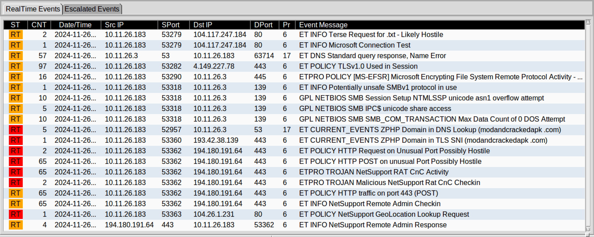
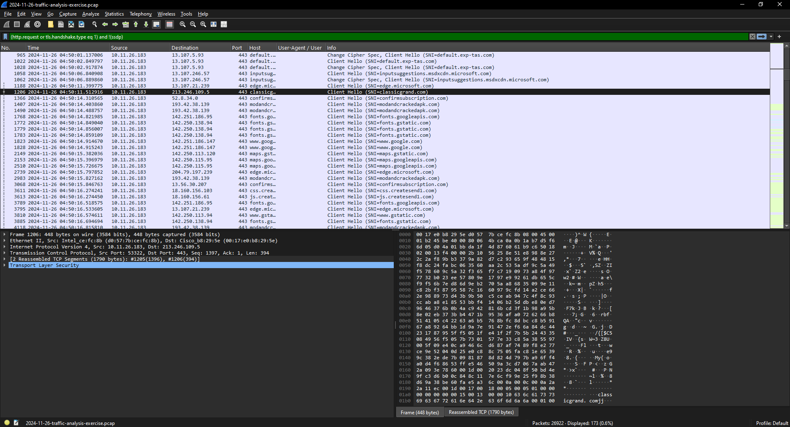
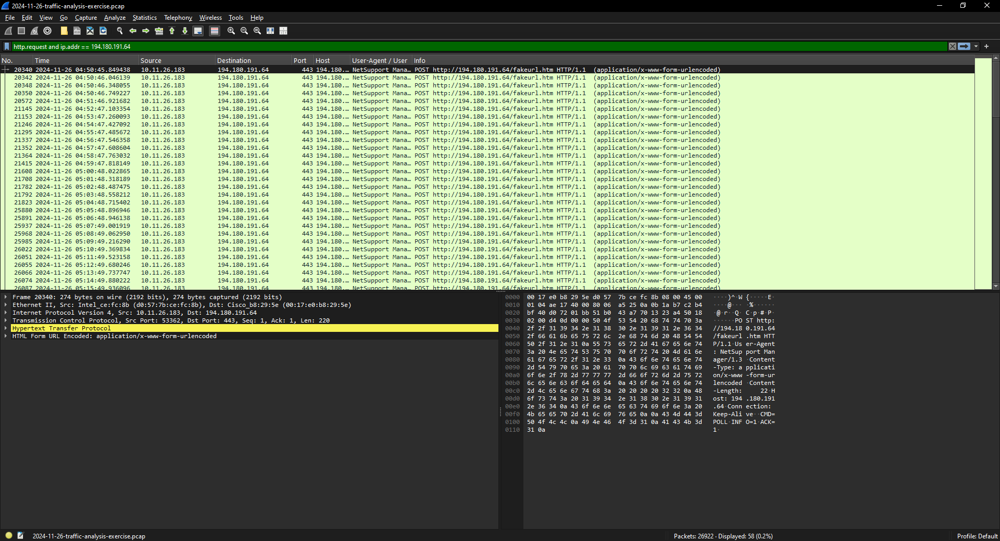

# 03: Fake browser update to NetSupport RAT

Exercise: [2024-11-26 "Nemotodes"](https://www.malware-traffic-analysis.net/2024/11/26/index.html)

Scenario: IDS alerts say a machine is infected. I got the alerts and the pcap and had to write the incident report.

## Summary

On 2024-11-26 at 04:50 UTC, Oliver Q. Boomwald (oboomwald) on DESKTOP-B8TQK49 visited classicgrand[.]com. That site was hacked and loaded a script from modandcrackedapk[.]com, which is part of the SmartApeSG/ZPHP fake browser update campaign. About 30 seconds later NetSupport RAT was running and checking in to 194.180.191[.]64 every minute.

## Victim

| | |
|---|---|
| IP | 10.11.26.183 |
| MAC | d0:57:7b:ce:fc:8b |
| Hostname | DESKTOP-B8TQK49 |
| User | oboomwald |
| Full name | Oliver Q. Boomwald |

## Going through the alerts

There were 19 different signatures, all from 10.11.26.183. Most of them were just normal Windows traffic:

- TLSv1.0, SMBv1, DNS name errors, MS-EFSR, the NETBIOS SMB ones: all traffic between the client and the domain controller. Not malicious.
- **ZPHP Domain in DNS Lookup / TLS SNI (modandcrackedapk .com)**: the start of the infection.
- **NetSupport GeoLocation Lookup**: the RAT checks where it is when it first starts.
- **NetSupport RAT CnC Activity / Checkin** and **HTTP POST on port 443**: 65 hits each, the active C2.

## Timeline (UTC)

| Time | What happened |
|---|---|
| 04:50:11 | Visits classicgrand[.]com |
| 04:50:14 | Page loads script from modandcrackedapk[.]com (193.42.38[.]139) |
| 04:50:45 | geo.netsupportsoftware.com/location/loca.asp |
| 04:50:45 | First C2 check-in to 194.180.191[.]64 |
| 04:50 - 05:43 | Check-ins about once a minute |

## How I found it

- Every alert had 10.11.26.183 as the internal IP, so that's the victim.
- `nbns` and `kerberos.CNameString` gave me the hostname, MAC and username.
- The full name came from `ldap.AttributeDescription == "givenName"`.
- With my basic web filter, the order is clear: classicgrand[.]com, then modandcrackedapk[.]com 3 seconds later, then nothing unusual until the NetSupport geo lookup and C2 30 seconds after that.
- `ip.addr == 194.180.191.64` shows the POSTs to /fakeurl.htm with the NetSupport user agent, same pattern as report #1.

The answer key lists the C2 as 194.180.191.164, but the pcap and the alerts both show 194.180.191.64, so I think that's a typo.

I didn't export the malware from the pcap, so there are no file hashes here.

## IOCs

```
classicgrand[.]com                    compromised site
modandcrackedapk[.]com                SmartApeSG fake update (193.42.38[.]139)
194.180.191[.]64:443                  NetSupport C2
hxxp://194.180.191[.]64/fakeurl.htm   check-in URL
```

## MITRE ATT&CK

- T1189 Drive-by Compromise (hacked website)
- T1204.002 User Execution: Malicious File (fake update)
- T1614 System Location Discovery (geo lookup)
- T1219 Remote Access Software (NetSupport)
- T1071.001 Web Protocols
- T1571 Non-Standard Port

## What I'd do

1. Isolate the machine and reset oboomwald's password.
2. Block the domains and the C2 IP.
3. Search DNS logs for anyone else who visited classicgrand[.]com or modandcrackedapk[.]com.
4. Reimage.
5. Remind users that Chrome and Edge update themselves. A website telling you to download an update is a red flag.

## Screenshots


*Alerts provided with the exercise*


